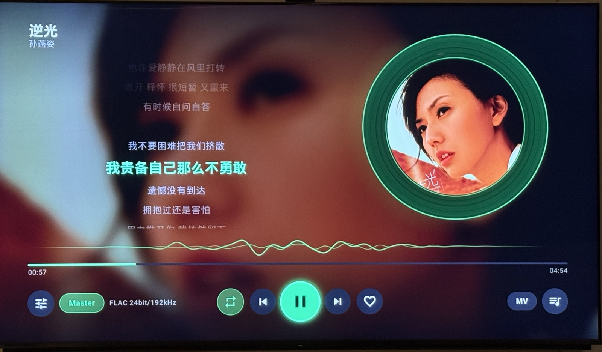
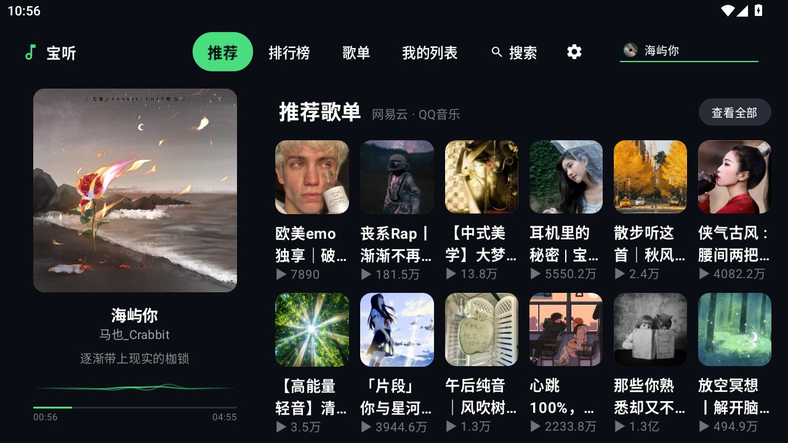
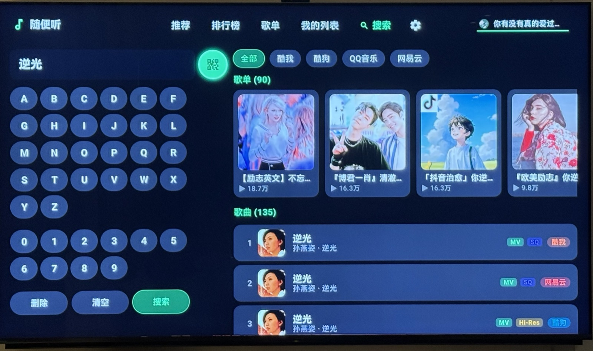
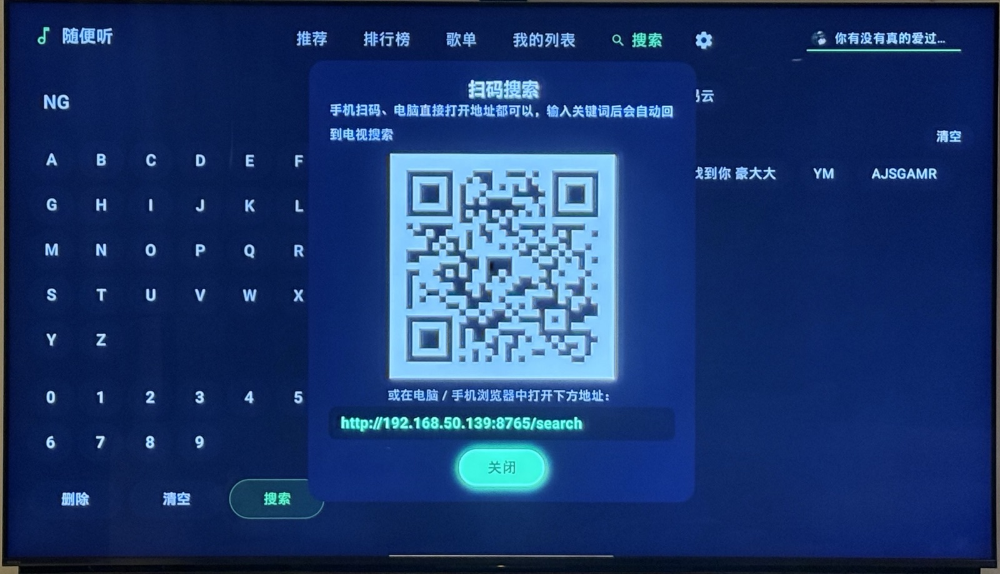
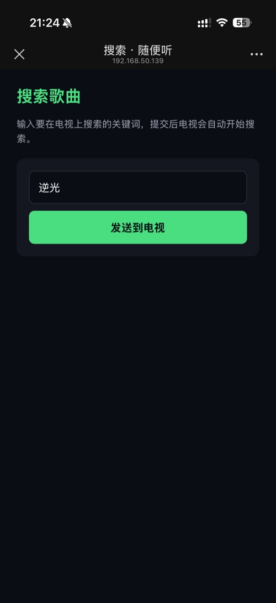

# 宝听 · baoting

> 面向 **Android TV / 投影仪** 的原生音乐播放器，遥控器（D-pad）友好。
> **本项目基于 [SincereXing/walkman-tv](https://github.com/SincereXing/walkman-tv) 二次修改**，
> Kotlin + Jetpack Compose for TV 编写，沿用原项目的 Apache-2.0 许可证。

<p>
  
  
  
  
  
</p>

---

## 一、这个项目是什么

上游 [walkman-tv](https://github.com/SincereXing/walkman-tv)（原名「随便听」）已经实现了一套完整的 TV 音乐播放器骨架：
多平台聚合搜索、排行榜、歌单广场、下载、本地导入、在线歌单导入、自定义音源（兼容洛雪 lx-music v4 脚本协议）、扫码输入等。

**宝听** 在这个骨架上做的是「**客厅观感 + 老电视稳定性**」方向的二改：

- 播放页按网易云风格重做，并加入多种全屏歌词特效；
- 把设置项按「用户真正会调的东西」重新归类、精简；
- 针对 Android 8 / 1.5GB 内存的老电视盒子做了一轮音频与内存加固（这批设备最容易「一按播放就闪退」）；
- 补上了**可自行扫码下载的调试报告**，方便定位线上崩溃。

> ⚠️ 与上游一致：**安装后必须先在「设置 → 连接与上传」配置至少一个自定义音源脚本**，否则无法解析播放地址。
> 内置直连仅作兜底，不保证可用。

---

## 二、适合谁用

| | 说明 |
|---|---|
| ✅ **老 Android TV / 投影仪**（Android 8/9、1.5GB 内存） | 默认软件解码、关闭音频直通与 float 输出，把「一按播放就闪退」的概率压到最低；界面全部为轻量 Compose Canvas 绘制，不依赖 WebView |
| ✅ **只用遥控器的客厅场景** | 所有控件为方向键设计，字号 / 间距按 3 米观看距离放大 |
| ✅ **喜欢网易云播放页观感的人** | 左封面右歌词、圆形黑胶、逐行歌词、全屏歌词特效（胶片还能用歌手写真做背景） |
| ✅ **想给家人做一台「纯净听歌机」的人** | 无广告、无推荐算法、无账号体系，数据全在本地 |
| ⚠️ **需要开箱即用的人** | 不适合：本项目不含任何音源，必须自行导入脚本 |
| ⚠️ **32 位老盒子** | 目前只构建 `arm64-v8a`；需要 32 位请自行调整 `app/build.gradle` 的 `splits`（见第六节） |

---

## 三、相对上游改了什么

> 逐条流水账见 [CHANGELOG.md](CHANGELOG.md)，下面按类别归纳。

### 1. 新增（上游没有的）

**全屏歌词特效（3 种）** — 「外观 → 全屏歌词特效」，也可用播放页底部控制栏的图标循环切换

- **光感**：居中三行（上一句 / 当前句 / 下一句）+ 柔和暗角，逐句淡入淡出；
- **星海**：深蓝星海背景 + 漂浮闪烁星点，当前句发蓝白辉光；
- **胶片**：**以歌手写真为背景** —— 通过网易云公开接口（`/api/song/detail` → 歌手 id → `/api/artist/{id}` 的 `img1v1Url`）自动抓取艺人宣传照，叠加「肯·伯恩斯」缓慢推近镜头 + 电影黑边 + 颗粒 + 暗角，歌词改为底部字幕式；取不到写真时回退专辑封面，结果按歌手名缓存。

**播放页动效** — 「外观 → 播放页动效」

- **波纹特效**：从唱片中心向外扩散的同心水波（参考 BMMusicPlayer）；
- **宇宙尘埃特效**：缓慢漂浮、明暗呼吸的尘埃粒子（参考 ParticleView）；
- 均为纯 Compose Canvas + `BlendMode.Screen`，不依赖 WebView / 着色器，老设备也能跑。

**字体系统** — 「歌词 → 歌词字体」

- 内置中文（歌词）字体 **「小抖动侠情书」**、**「Aa祝你我明媚向春天」**，随包无需联网；
- 支持 **上传 ttf / otf / woff2** 与 **手机扫码上传**，每个字体用自身渲染做预览；
- 字体**只作用于歌词**，不改动其余界面文字。

**调试与可观测性** — 「关于与更新 → 调试」

- 全局崩溃收集：未捕获异常写入 `filesDir/debug/crash-*.txt`（保留最近 10 份）；
- **操作轨迹（breadcrumbs）**：`playAt` / `prepare` / `ready` / `playerError` / `audioFormat` / `audioDecoder` / `audioUnderrun` 逐步落盘，**原生崩溃（SIGSEGV）也能看出死在哪个阶段**；
- **扫码下载调试报告**：点「生成调试信息（扫码下载）」，或用手机访问 `http://电视IP:8765/debug`。报告包含设备信息、硬件解码能力、当前设置 JSON、崩溃堆栈、操作轨迹、`logcat -b crash`（tombstone 摘要）。

**其他**

- 关于页展示设备信息（机型 / 系统 / 内存 / 分辨率 / 密度）与**硬件音频解码格式**（只读，不可点击）；
- 唱片大小步进调节（0.5×–3.0×，默认 1.0×），封面与动效中心同步缩放；
- 歌词新增**跨平台搜索兜底**：直接按「歌名 + 歌手」搜同名歌词。

### 2. 改造（上游有，但行为 / 观感不同）

| 项目 | 上游 | 本项目 |
|---|---|---|
| 应用名 / 图标 | 随便听 | **宝听**，重绘桌面图标与 TV 横幅；包名仍为 `com.baogemusic.tv`，可覆盖升级 |
| 播放界面 | 模糊背景 + 旋转黑胶，后续有过 BetterLyrics 双风格 | **固定「复刻网易」两栏**（左封面 · 右歌词），移除风格切换；播放页不显示来源平台标签 |
| 设置结构 | 通用 / 播放 / 歌词 / 外观 / 连接 / 下载 / 关于（7 项） | **合并为 6 项**：「通用」并入「播放」；字体移入「歌词」；全屏歌词特效移入「外观」；「黑胶颜色」与「唱片形状」合并为「唱片」 |
| 歌词字号 / 行距 | 倍率 1.0–3.0 | 字号改为**实际 sp 值**（16–72，默认 40）；行距 0.5–2.0 倍（步长 0.1，默认 0.9） |
| 排行榜 / 歌单默认音源 | 酷我 | **网易云** |
| 发现页音源默认 | 全开 | **仅网易云 + QQ 音乐** |
| 播放控件自动隐藏 | 默认关 | **默认开**（5 秒无操作隐藏） |
| 唱片形状 / 排布默认 | 圆角方形 · 唱片左 | **圆形 · 歌词左 · 唱片右** |
| 缓存上限 | 固定值 | 步进器 0.5–5GB（步长 0.5），并从「通用」移到「下载」页 |

### 3. 优化

**老设备音频加固（本项目重点）**

- **强制软件解码默认开启**、**Hi-Res 硬件直通默认关闭**（Android 10 以下一律禁用直通）；
- 软件解码时**只选 AOSP 解码器**（`c2.android.*` / `OMX.google.*`）——部分厂商解码器自称 `software`，实际仍在 OMX 组件里跑，喂某些 MP3 会在 native 层崩溃；
- **API < 29**：关闭 float 音频输出（退回 16bit PCM）、缓冲从 30s/60s 降到 20s/40s；
- 解码失败（`DECODER_INIT_FAILED` / `DECODING_FAILED` / `AUDIO_TRACK_INIT_FAILED`）自动切软解并重试一次；
- 老存档通过 `schemaVersion` 做一次性迁移，升级后自动切到软解，不用手动找开关。

**内存与渲染**

- 图片加载器内存缓存按进程可用内存 1/16 封顶（≤64MB），磁盘缓存按设置上限，关闭硬件位图；
- 封面模糊的 RenderScript **复用同一上下文**（原先每张封面新建一个，native 内存容易被耗光），输入尺寸封顶 720px，失败时降级为未模糊图；
- 播放页特效 Canvas 全部加零尺寸保护，避免 `radialGradient(radius = 0)` 抛异常。

**体验与链路**

- 歌词抓取：用户脚本 → 同平台直连 → 按设置顺序换源 → **按名字跨平台搜索兜底**（酷狗 → 网易云 → QQ），显著减少「正常歌却没歌词」；
- 所有 IO 走 `Dispatchers.IO`，后台协程加 `CoroutineExceptionHandler`，异常不再直接把进程带崩；
- 首页 / 歌单卡片尺寸统一，平台标签顺序统一为 网易云 → QQ → 酷狗 → 酷我。

### 4. 修复

- **「点击播放即闪退」（Android 8 / MStar 等老芯片）**：音频 offload 在原生层崩溃 → 默认关闭，且仅在 API ≥ 29 且用户显式开启时启用；
- 未捕获异常、协程异常、`MediaCodecList` / `WindowManager` 调用异常、音频文件头探测异常均已兜底，不再直接崩溃进程；
- 修复首页卡片大小不一、播放页波纹中心与唱片不同心等视觉问题。

### 5. 移除

- BetterLyrics 播放界面与「播放界面 UI」切换（按要求固定为复刻网易）；
- 「鲸鱼特效」（原复刻网易鲸云音效）、「神光」动效；
- 极光 / 霓虹 两种全屏歌词样式（保留光感 / 星海 / 胶片）；
- 内置「苹方-港」字体（替换为「Aa祝你我明媚向春天」）。

---

## 四、界面预览

> 下列截图来自上游版本，用于说明整体布局；本项目已更名「宝听」并重做了播放页与设置页，截图后续更新。



| 推荐首页 | 搜索 |
|:--:|:--:|
|  |  |

| 扫码输入（电视出码） | 手机端输入页（局域网直连） |
|:--:|:--:|
|  |  |

---

## 五、下载与安装

从 **Releases** 下载 `baoge-tv-<版本>-arm64-v8a-release.apk`：

```bash
adb connect <电视IP>:5555
adb install -r baoge-tv-1.4.7-arm64-v8a-release.apk
```

或用 U 盘拷到电视，用「文件管理器 / 安装包安装器」打开（首次需允许「未知来源」）。
要求 **Android 6.0+（minSdk 23）**，ABI **arm64-v8a**。

> 仓库内自构建的 release APK 默认使用 **debug 签名**（仅便于测试安装）。要正式签名，把
> `release.keystore` + `keystore.properties` 放进 `app/`，或配置 GitHub Actions 的四个 Secrets。

---

## 六、从源码构建

```bash
# 需要 JDK 17 + Android SDK
git clone <this repo>
cd <repo>
echo "sdk.dir=/path/to/Android/sdk" > local.properties
./gradlew assembleRelease
# 产物：app/build/outputs/apk/release/baoge-tv-<version>-arm64-v8a-release.apk
```

需要 32 位 / 通用包时，改 `app/build.gradle`：

```groovy
splits {
    abi {
        enable true
        reset()
        include "arm64-v8a", "armeabi-v7a"
        universalApk true
    }
}
```

---

## 七、源码结构

```
app/src/main/java/com/baogemusic/tv/
├── App.kt / MainActivity.kt        入口、全局崩溃捕获
├── data/
│   ├── model/                      Track / Playlist / SourceID / Quality 等领域模型
│   └── store/                      设置、收藏、下载、字体、歌手写真、调试报告等本地存储
├── di/                             手写依赖容器 AppContainer、内置 HTTP 服务（扫码输入 / 调试下载）
├── playback/                       ExoPlayer 控制器、歌词解析与抓取、均衡器、下载器、更新器
│   └── download/                   下载协调、标签写入（ID3v2.4 / FLAC）
├── source/                         音源：内置直连（catalog）、自定义脚本（js / QuickJS）、换源匹配
└── ui/
    ├── player/                     播放页（复刻网易舞台、全屏歌词特效、动效）
    ├── settings/                   设置页（6 个一级页）
    ├── recommend / search / library / leaderboard / songlist
    ├── components/                 共用控件（卡片、胶囊、波形、模糊、对话框）
    └── theme/                      配色与字体
```

关键入口：

- 播放页：`ui/player/PlayerScreen.kt`
- 设置：`ui/settings/SettingsScreen.kt`（路由）+ `SettingsPages.kt`（各页实现）
- 播放控制：`playback/PlaybackController.kt`
- 歌词：`playback/LyricsFetcher.kt` + `source/builtin/BuiltInLyricResolver.kt`
- 歌手写真：`data/store/ArtistPhotoStore.kt`

---

## 八、已知问题与排查

**播放时闪退？**

1. 「设置 → 播放 → 音频解码」确认 **强制软件解码 = 开**、**Hi-Res 硬件直通 = 关**（升级后应已自动设置）；
2. 「设置 → 关于与更新 → 调试 → 生成调试信息（扫码下载）」，把 `debug-report.txt` 提交到 Issues；
3. 报告里的「操作轨迹」与 `logcat -b crash` 段能直接定位崩溃阶段与解码器名称。

**没有歌词？**

依次尝试：自定义源 → 同平台直连 → 按设置顺序换源 → 按歌名 + 歌手跨平台搜索（酷狗 → 网易云 → QQ）。
若仍为空，多为该曲在各大平台都没有同步歌词（纯音乐 / 翻唱 / 现场版）。

---

## 九、免责声明

- 本项目**不提供、不存储、不分发任何音频内容**，所有播放地址均由用户自行配置的第三方脚本解析；
- 请仅用于**个人学习与技术研究**，不要在未获授权的情况下传播受版权保护的内容；
- 因使用本项目产生的任何版权纠纷或法律风险，由使用者自行承担；
- 与任何音乐平台、洛雪音乐项目均无隶属或合作关系。

---

## 十、致谢

- 上游项目：[SincereXing/walkman-tv](https://github.com/SincereXing/walkman-tv) —— 本项目的全部架构与基础功能来源；
- 自定义源协议：[lx-music](https://github.com/lyswhut/lx-music-desktop) v4 脚本规范；
- 动效灵感：[BMMusicPlayer](https://github.com/birdmichael/BMMusicPlayer)、[ParticleView](https://github.com/MlxChange/ParticleView)；
- 播放内核：AndroidX [Media3 / ExoPlayer](https://github.com/androidx/media)；
- 字体：「小抖动侠情书」、「Aa祝你我明媚向春天」（非商业使用）。

## 许可证

[Apache-2.0](LICENSE)，与上游一致。二次修改与再分发请保留原始版权声明。
